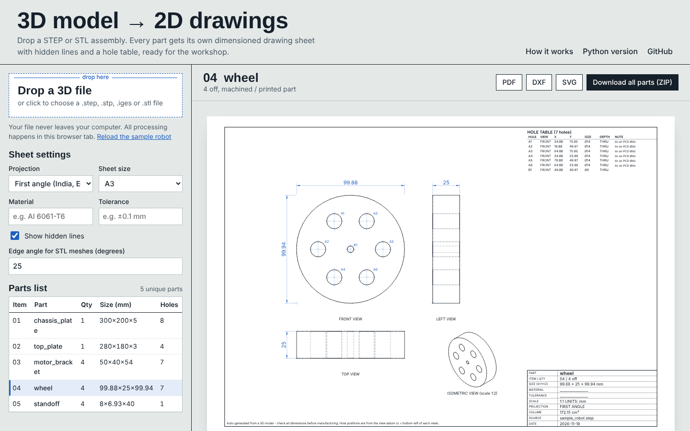

# 3D to 2D drawing converter

Turn a robot or any other assembly (**STEP, IGES or STL**) into **2D manufacturing drawings for every part**. It's free, and the web version runs entirely in your browser.

**▶ Live website: https://srivatsa-dotcom.github.io/3d_to_2d_drawing_converter/**



## What you get for each part
- **Front, top and side views** with hidden lines dashed (first- or third-angle projection), plus an **isometric view**
- **Overall dimensions** and a **title block** with part name, quantity, size, scale, projection, material, tolerance and volume
- A **hole table** with position from a datum, diameter, THRU or depth, counterbore, bolt-circle PCD and an M3/M4… hint
- Downloads as **PDF**, **DXF** (true size, in mm) and **SVG**, plus a **1:1 laser-cut DXF** for flat plates
- **Download all parts as a ZIP**: every drawing, `ALL_DRAWINGS.pdf` and `BOM.csv`

## How parts are handled
- Identical parts (4 wheels, 8 brackets…) get **one drawing with the right quantity**
- STEP part names are kept. Screws, nuts and bearings are recognised by name and listed as purchased hardware.
- Parts placed at an angle are rotated square before drawing
- STL meshes are split into separate bodies, and edges are found by face angle

## Use it
### In the browser (no install)
Open the [website](https://srivatsa-dotcom.github.io/3d_to_2d_drawing_converter/) and drop your file. Your file never leaves your computer: STEP files are read with OpenCascade compiled to WebAssembly ([occt-import-js](https://github.com/kovacsv/occt-import-js)).

### Python command line (batch or offline use, exact geometry)
```bash
pip install -r python/requirements.txt
python python/step2drawings.py robot.step -o drawings        # STEP / STP assemblies
python python/stl2drawings.py  model.stl  -o drawings        # STL meshes
```
Options include `--projection third`, `--sheet A4`, `--no-hidden` and `--include-hardware`. Run with `-h` to see all of them.

## Repository layout
```
docs/            GitHub Pages website (in-browser converter)
  index.html     page and UI
  js/core.js     geometry engine: part split, hidden-line projection, hole detection, sheet, PDF/DXF/SVG
  js/app.js      UI wiring
  vendor/        occt-import-js (WASM), jsPDF, JSZip
  samples/       sample_robot.step (loads on open)
python/          command-line versions (CadQuery / OpenCascade)
examples/        example output PDFs
```

## Limits (check before manufacturing)
- Tolerances, thread callouts, surface finish and dimensions for slots or pockets are **not** added automatically. Add them in the DXF.
- STL files have no part names and only faceted circles. If an STL fuses several parts into one body, export the parts separately or use STEP.
- Hole hints ending in "?" are guesses.

## Credits
[occt-import-js](https://github.com/kovacsv/occt-import-js) / [Open CASCADE](https://dev.opencascade.org/) (LGPL), [jsPDF](https://github.com/parallax/jsPDF) (MIT), [JSZip](https://github.com/Stuk/jszip) (MIT), [CadQuery](https://github.com/CadQuery/cadquery), [ezdxf](https://github.com/mozman/ezdxf), [trimesh](https://github.com/mikedh/trimesh).
